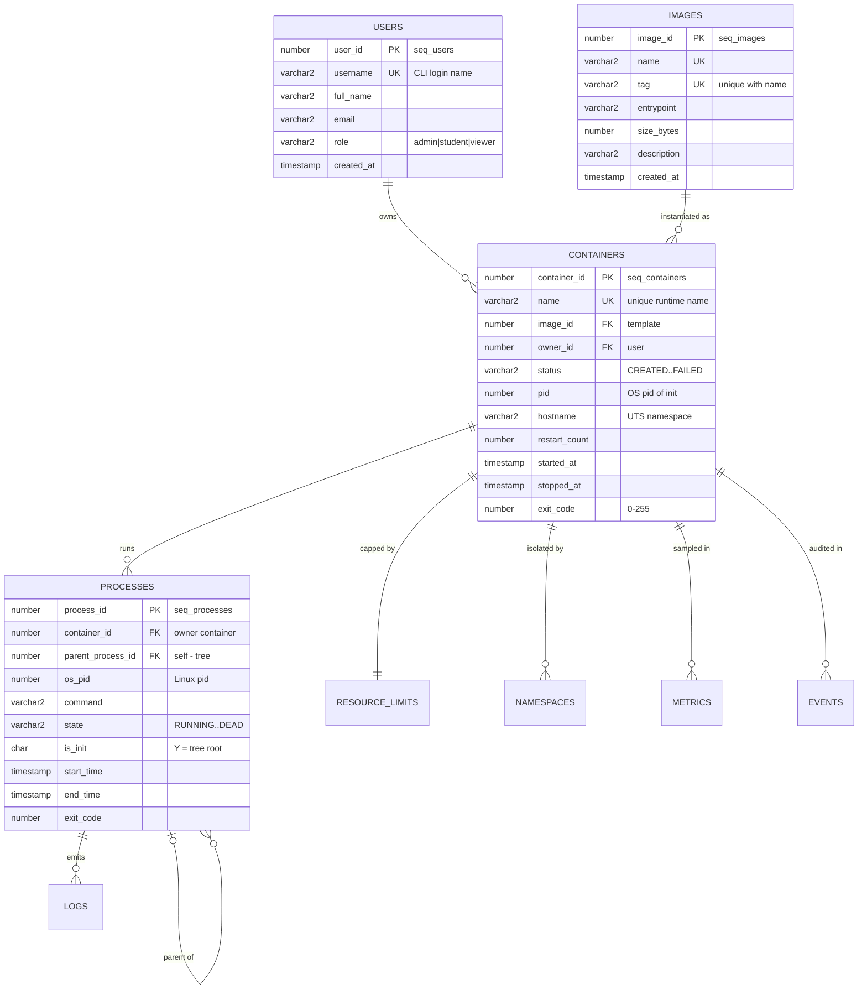
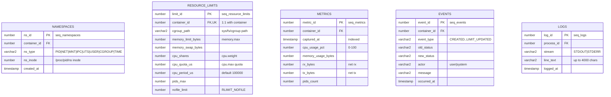

# ContainerLite — ER Diagram

For the PBL project **“A Lightweight Container Runtime with OS-Level Process
Management and an Oracle-Backed State Store”**.

Nine entities. `containers` is the hub: everything the runtime does — spawn
processes, isolate namespaces, cap resources, sample metrics, audit events —
hangs off it.



```



## Cardinality summary

| Relationship | Cardinality | Notes |
|---|---|---|
| USERS → CONTAINERS | 1 : N | `ON DELETE CASCADE` removes a user's containers |
| IMAGES → CONTAINERS | 1 : N | **No cascade** — an image in use cannot be deleted (ORA-02292) |
| CONTAINERS → PROCESSES | 1 : N | cascade delete with container |
| PROCESSES → PROCESSES | 0..1 : N | self-FK builds the OS process tree (`CONNECT BY`) |
| CONTAINERS → RESOURCE_LIMITS | 1 : 0..1 | `UNIQUE(container_id)` enforces one active cap |
| CONTAINERS → NAMESPACES | 1 : N | `UNIQUE(container_id, ns_type)` — one namespace per type |
| CONTAINERS → METRICS | 1 : N | monitor loop appends samples |
| CONTAINERS → EVENTS | 1 : N | rows written automatically by triggers |
| PROCESSES → LOGS | 1 : N | stdout/stderr capture |

Render this in any Mermaid-aware viewer (VS Code extension, GitHub, or open
[er-diagram.html](er-diagram.html) offline).
